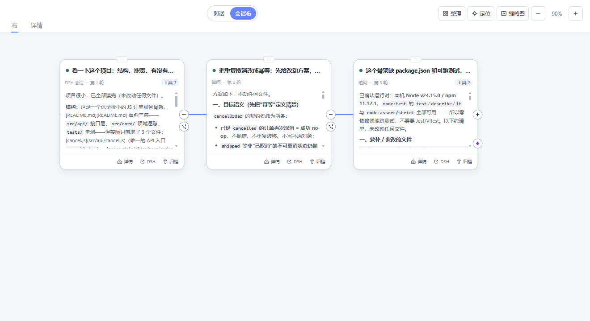

# dsh-miasaki

> **DeepSeek Harness 的插件集**。九个模块，覆盖会话可视化、远程运维、外观定制、用量统计与多 Agent 编排。
>
> 共同约定：**零 shell 改动、零第三方依赖**（只用 DSH 官方扩展点）；**装上即用，关掉即原生**。

[](https://github.com/Miasakiii/dsh-miasaki/actions/workflows/verify-all.yml)

> ### ✅ 已发布到 npm（2026-10-12 首发）
>
> 七个插件全部上架，`dsh plugin add` **可以直接用了**：
>
> ```bash
> dsh plugin --profile web add @miasaki/dsh-canvas
> ```
>
> **进度如实说**：静态回归 **183 项**全绿、分发包 **7/7** 实测可打包、依赖声明与脱敏逐项核过；
> 但[实机验收台账](dsh-miasaki-shared-docs/cross/smoke-test-matrix.md) 是 **72 / 127 项**
> （勾选口径 = 日常使用确认；需刻意构造或特殊环境的项仍留空）——
> 装机遇到问题请[开 issue](https://github.com/Miasakiii/dsh-miasaki/issues)，别自己扛。

---

## 会话布 · Canvas



把会话从「一条时间线」变成**一张可拖拽的地图**。

每条追问是一条分支，两条线可以**合并**成一条新会话；节点保留真实的 DSH 会话血缘，
DSH 原生会话始终是唯一事实来源——画布只是它的视图。

| 能力 | 说明 |
|---|---|
| **分支** | 从任意节点起一条新线，血缘由 `sourceParentSessionId` 忠实记录 |
| **合并** | 双线汇合产出**真实 DSH 会话**：全文引用（精确）或摘要提炼（省上下文） |
| **浏览** | 会话血缘树侧栏、小地图、三档缩放（全文 / 摘要 / 只留卡头） |
| **不变本体** | 不改系统提示、不改模型请求、不改工具 schema |

```bash
dsh plugin --profile web add @miasaki/dsh-canvas
```

---

## 插件一览

### DSH Web 插件

装上后重启 `dsh web` 并刷新页面生效。

| 插件 | 一句话 | 包名 |
|---|---|---|
| **会话布** | 可浏览 / 可分支 / 可合并的会话画布 | `@miasaki/dsh-canvas` |
| **SSH** | 不切终端，在 DSH 里直连服务器：多 shell、SFTP、跳板、端口转发 | `@miasaki/dsh-ssh` |
| **侧边栏** | 官方右栏的「审查」与「辅助对话」两个 tab，外加底部内嵌终端 | `@miasaki/dsh-sidebar` |
| **外观** | 设置里多一栏「外观」：皮肤 / 壁纸 / 动效 / 启动片头 | `@miasaki/dsh-appearance` |
| **双模型** | 会话级「主模型 + 辅助模型」，任一支持图片即可发图 | `@miasaki/dsh-dual-model` |
| **用量统计** | 每个会话烧了多少 token：实时明细、年热力图、趋势、今日限额 | `@miasaki/dsh-token-monitor` |
| **免费模型** | 把本机所有免费模型聚成一张表，带能力画像与一键设默认 | `@miasaki/dsh-free-model` |

> **用量统计**是唯一「纯官方契约、零 miasaki 耦合」的插件——只用官方扩展点，可单独装进任意官方 DSH profile。

### 桌面端

Windows 桌面壳：双击 EXE → **全屏视频开机片头**（七段可选，设置 → 外观 → 启动）→ 自动拉起 DSH →
自带**三套主题皮肤**（原版纯净 / 刻刻帝 / 狂狂帝）
与一只**会跟着工作状态变化的桌宠**（思考 / 等待 / 出错 / 完成，六态），可拖动、可吸附屏幕边缘。

装完插件、改完设置**不必退出重开**：托盘菜单、桌宠右键、标题栏主题面板三处都有
**「重启 DSH 服务」**—— 只重启后端，窗口与桌宠不重建；片头**跟随**「设置 → 外观 → 启动」里
选的那一段（2026-10-12 订正：原写「片头不重放」，被用户否掉 —— 两个不同的加载画面反而分不清状态）。
停机段已由 2–3s 压到约 0.1s（2026-10-12 提速：软杀档改判据驱动 + 强杀走 Win32 树终止 + 观察窗改轮询；
余下约 3s 是 DSH 后端启动的硬成本），几秒后自动回到 DSH
（后端起不来时会停在加载页并给出「重试 / 恢复选项」，不会卡成打不开的应用）。

不修改 DSH 本体：主题以令牌层覆盖实现，DSH 升级不受影响。

### Fleet

多 Agent CLI 编排：**一个总指挥 + N 个 worker**，以文件总线为唯一协调通道。
面向开发者的工具，不是 DSH 插件。

---

## 安装

**前置**：已安装 DSH（`dsh` 在 PATH 中）。

> `dsh plugin` **必须带 `--profile <名字>`** —— 插件是按 profile 装的。
> 常见取值：`web`（浏览器 GUI）、`desktop`（官方桌面端），或你自建的名字。

### 从 npm 安装（推荐）

```bash
dsh plugin --profile web add @miasaki/dsh-canvas
# 换包名即装其它插件：@miasaki/dsh-ssh / @miasaki/dsh-sidebar / @miasaki/dsh-appearance
#                     @miasaki/dsh-dual-model / @miasaki/dsh-token-monitor / @miasaki/dsh-free-model
# 装完重启 DSH，再刷新页面
```

各线 README 写有该线的本体补丁步骤（部分插件需要，补丁文件随包分发）。

卸载：`dsh plugin --profile web remove <包名>` —— 依赖与插件层一并移除。

### 从源码安装（改代码即时生效）

clone 本仓后，以 `link:` 方式装进 profile：

```bash
dsh plugin --profile web add link:<仓库路径>/dsh-miasaki-canvas
```

> **用 `link:` 不要用 `file:`** —— `file:` 会把包**复制**进 profile（是快照、不跟源码），
> 症状是「改了代码、重启也不生效」且不报任何错。

### 兼容性

插件跟随 DSH 版本迭代，请对照下表安装：

| DSH 版本 | 状态 |
|---|---|
| **0.2.1-rc.2** | **当前实装**（2026-10-17 升级：九件补丁已重打/重写、预设 `backgroundMode` 已迁移；两个第三方插件已升级/豁免，见桌面端 CHANGELOG） |
| **0.2.0-rc.2** | 已复验（上一实装版本：八件补丁已重打，`patch-live-audit` 10/10 patched） |
| **0.2.0-rc.1** | 已复验 |
| **0.1.7 及以上** | 支持（canvas 已按 0.1.7 的 `uiWorkspace` 契约适配） |
| 0.1.5 / 0.1.6 | 历史版本，双模型等插件做了新旧事件双轨兼容 |

装到不匹配的 DSH 上通常表现为**插件整包加载失败或白屏**——升级 DSH 后请一并升级插件。

---

<!-- version-ledger:start — 由 `scripts/check-doc-versions.mjs` 校验；改 package.json 版本后跑 `node scripts/check-doc-versions.mjs --update` -->
**版本台账**（机器校验的唯一版本来源；上表正文里的版本号是叙述，冲突以本表为准）：

| 线 | 目录 | `package.json` |
|---|---|---|
| 桌面端 | `dsh-miasaki-desktop/` | 0.1.0 |
| Fleet | `dsh-miasaki-fleet/` | 0.20.0 |
| Canvas | `dsh-miasaki-canvas/` | 0.5.0 |
| Sidebar | `dsh-miasaki-sidebar/` | 0.10.0 |
| SSH | `dsh-miasaki-ssh/` | 0.1.0 |
| 双模型 | `dsh-miasaki-dual-model/` | 0.1.3 |
| 外观 | `dsh-miasaki-appearance/` | 0.1.0 |
| 用量统计 | `dsh-miasaki-usage/` | 0.6.1 |
| 免费模型 | `dsh-miasaki-free-model/` | 0.4.0 |
<!-- version-ledger:end -->

---

## 文档

| 找什么 | 去哪 |
|---|---|
| 单个插件的用法与限制 | 各线目录下的 `README.md` |
| 设计决策与变更记录 | 各线 `design/`（desktop / canvas / sidebar / ssh / dual-model / appearance / usage / free-model） |
| **工程记录**（线级现状、统一回归的全部历史基线、开发命令） | [`docs/ENGINEERING.md`](docs/ENGINEERING.md) |
| 跨线契约与平台调研 | [`dsh-miasaki-shared-docs/`](dsh-miasaki-shared-docs/) |

**统一回归**（九线 + 仓库级治理闸门，CI 在 `windows-latest` 上跑同一套）：

```bash
node scripts/verify-all.mjs               # 全量
node scripts/verify-all.mjs canvas        # 只跑一条线
```

## License

各插件包均为 MIT，见各自目录下的 `LICENSE`。
